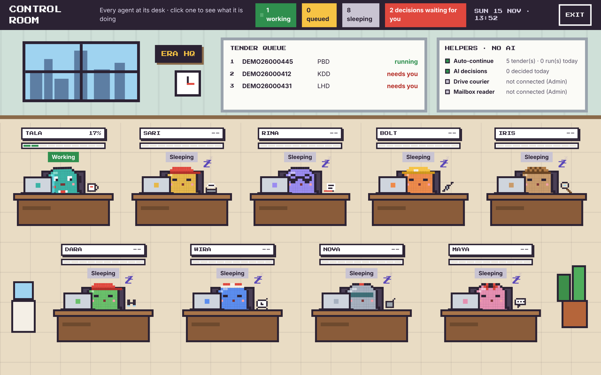
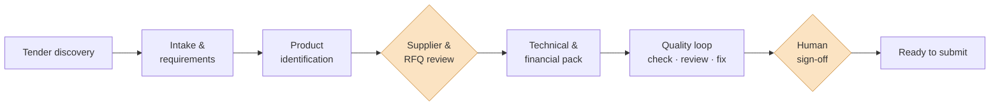
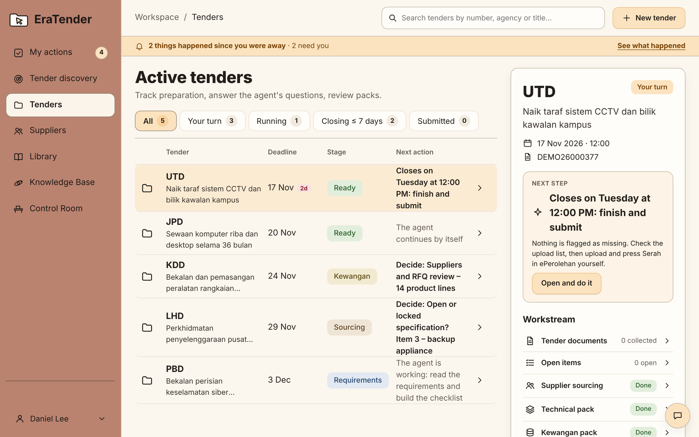
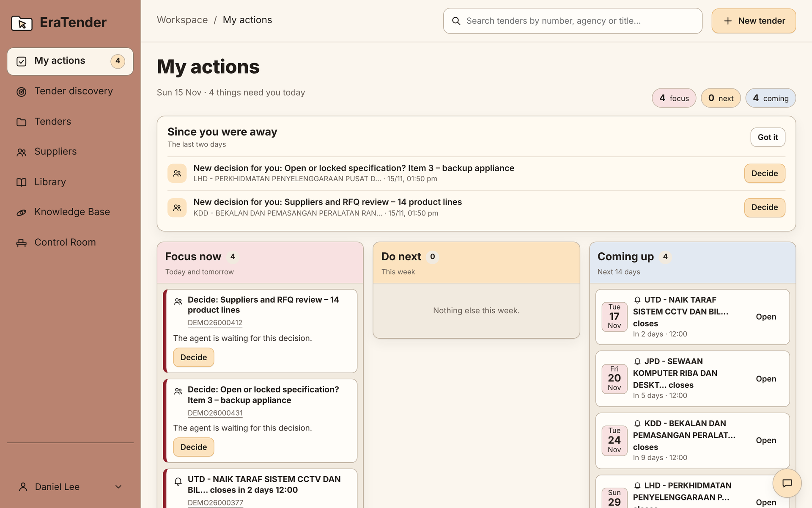
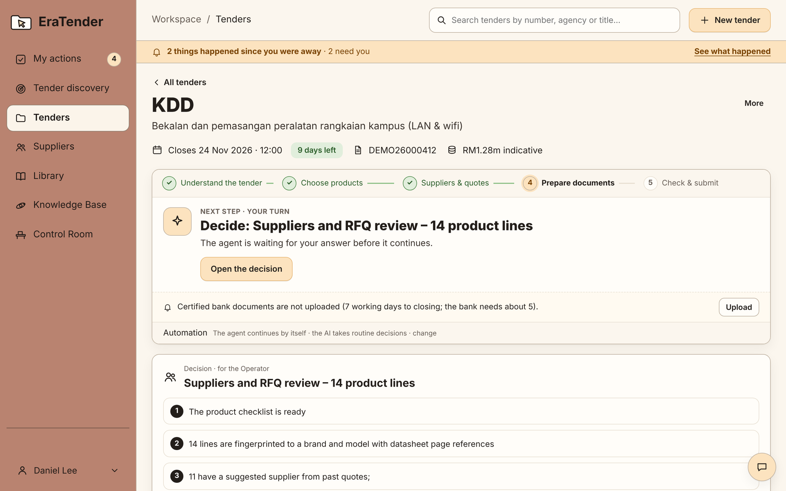
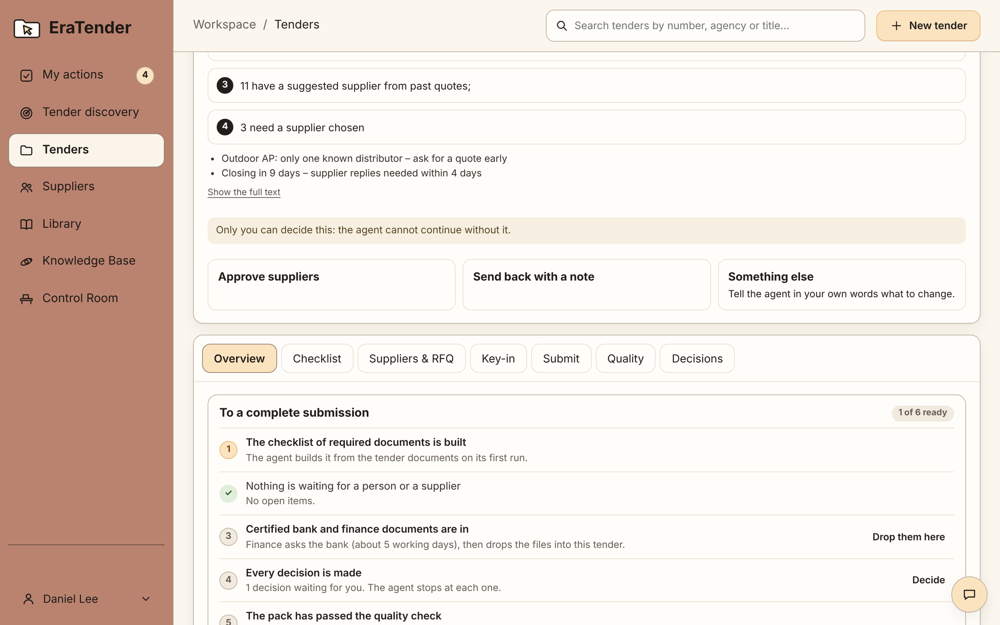

# EraTender — Agentic Tender Response Platform

**From a tender number to a submission-ready pack: AI agents do the routine work, and people make the decisions.**

> This is a showcase repository. EraTender is a commercial product, and its source code, agent instructions and rule sets are private.
> All screenshots use made-up demo data. **Interested in a demo or using it in your business? [Contact me](#contact).**

---

## The problem

Preparing a Malaysian government tender (ePerolehan / MyProcurement) is slow and error-prone. A small bid team has to:

- find tenders that match the company's categories before they close
- read hundreds of pages and find every mandatory requirement
- work out which brand and model the specification was written around
- chase suppliers for quotations, brochures and letters of authorisation
- fill the agency's own forms exactly as given, write the technical proposal and the portal answers
- check everything again before pressing Submit

A single missed document or a non-compliant spec line can disqualify the whole bid.

## What EraTender does

| | |
|---|---|
| **Finds tenders** | Reads the public notice boards on a schedule, keeps the ones that fit the company's work, and flags mandatory briefings and closing dates. |
| **Understands the tender** | Downloads the documents, builds a requirement register and a house-style checklist, and marks each item as an open or locked specification. |
| **Finds the products** | Identifies the brand and model behind each spec item, gets the official datasheet, and checks every spec line with page references. |
| **Works with suppliers** | Builds the supplier table, drafts one short RFQ per supplier for a person to send, and updates every affected document when replies arrive. |
| **Writes the pack** | Fills the agency forms without redrafting them, and writes the technical proposal, the compliance answers and the portal key-in text. |
| **Checks itself** | Fixed automatic checks, then an independent AI reviewer, then fixes and a verification round. The app enforces this; the agent can't skip it. |
| **Keeps people in control** | One clear "next step" per tender, a My actions board, and short decision cards. People keep everything that commits the company: prices, signatures, sending e-mail and pressing Submit. |

## How it works

The orange steps are **human decision gates**. Everywhere else, the agents keep working on their own. They continue without waiting for supplier replies and update the pack when the replies come in.

### Built-in safety boundaries
- Agents can **never** enter prices, accept declarations, upload files or press Submit in the portal. This is enforced in code, not left to a prompt.
- No passwords are given to the AI.
- Every fact in a document traces back to a source file and page. Anything unknown is left blank and raised as an open item, never guessed.
- Each tender is fully separate, and data from one tender is never copied into another.

## Screenshots

**Active tenders: every tender, its stage, and the one next action**

**My actions: what needs a person today, this week, and coming up**

**Tender page: progress across five stages, with the next step at the top**

**Decision card: the agent explains, recommends, and waits for a person**

**Control Room: a live view of every agent and background helper (the image at the top)**

## Results so far

- The agents need about **0.5–2.5 hours of working time per tender**, compared with days of manual preparation.
- It has run end to end on real government tenders, from document download to a submission-ready pack.
- An independent review step catches problems before a person sees the pack.

## Technology (high level)

Python · React · Claude Agent SDK (multi-agent orchestration) · Playwright (portal automation with guardrails) · SQLite · Docker · Google Drive and Microsoft 365 integrations

## Contact

EraTender is available for other bid teams and businesses that prepare tenders.
For a live demo, pilot or licensing, message me on **[LinkedIn](https://www.linkedin.com/in/imran-sidin/)**.

---

© 2026 Imran S. All rights reserved. See [LICENSE](LICENSE).
